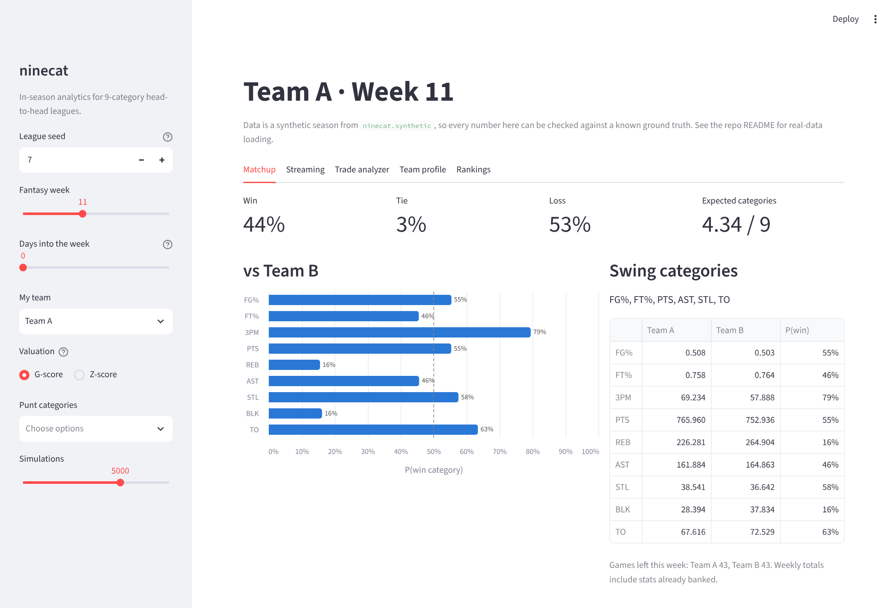
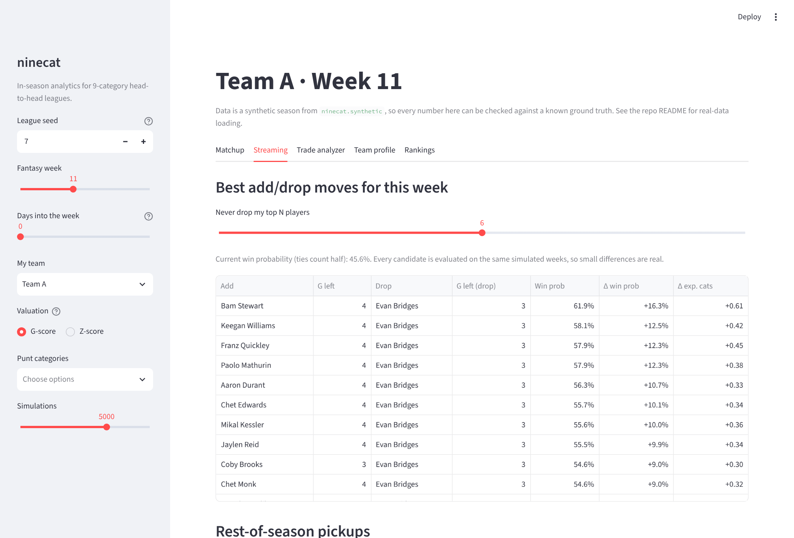

# ninecat

**In-season decision tools for 9-category head-to-head fantasy basketball, built
on a tested statistical engine.**

Most fantasy tools stop at draft day and rank players by summed Z-scores.
`ninecat` is aimed at the rest of the season, where you have to decide every week:

* **Will I win this week?** Monte Carlo simulation of your matchup, category by
  category, including stats already banked mid-week.
* **Who should I stream?** Every (add, drop) pair ranked by how much it raises
  *this week's* win probability.
* **Should I take this trade?** Both rosters re-simulated against the whole
  league, with the change in weekly win rate and in each category.
* **What should I punt?** Category strength against the league, with punt
  suggestions and rankings that re-weight instantly.

Each model behind these answers is backtested. Where a backtest contradicted my
assumptions, I changed the model (see [what the data changed](#what-the-backtests-changed)).



## Results at a glance

Full report: [`reports/results.md`](reports/results.md). Method:
[`docs/methodology.md`](docs/methodology.md).

| | Result |
|---|---|
| Rest-of-season projections | **16% lower MSE** than season averages (averaged over 12 stats and 5 held-out seasons); "last 15 games" is **23% worse** |
| Matchup simulator | Calibrated: category win probabilities within ~3 points of observed rates on average (ECE ≈ 0.03 over 3,400 categories) |
| G-scores vs. Z-scores | G-scores rank players by simulated marginal value better (Spearman **0.988 vs 0.963**) |

<p>


</p>

## How it works

```
game logs ─► projections ─────────► G-scores ─► rankings, punts, pickups
             (empirical Bayes,          │
              minutes, availability)    ▼
                     └────────────► week simulator ─► matchup odds, streaming, trades
                                    (negative binomial, parameter
                                     uncertainty, common random numbers)
```

* **Projections:** per-minute rates with Gamma–Poisson **empirical-Bayes
  shrinkage** toward the player's position, with prior strength estimated
  from the data for each stat; Beta–Binomial shooting percentages; separate
  recency-weighted models for minutes and availability.
* **Valuation:** Z-scores and **G-scores** (Rosenof 2024,
  [arXiv:2307.02188](https://arxiv.org/abs/2307.02188)), which discount
  categories that are volatile week to week. Percentages are volume-weighted.
* **Simulation:** weekly totals from negative-binomial counts, binomial makes,
  binomial games played, and posterior draws of each player's true rates. All
  player-weeks are drawn once (**common random numbers**), so comparing 500
  add/drop pairs is one vectorised pass with very little noise between them.
* **Evaluation:** a synthetic season generator with known ground truth (aging,
  drifting form, role changes, injury spells, consistent box scores). It
  separates tuning seeds from evaluation seeds and reports calibration, not
  only accuracy.

### What the backtests changed

* **Recency weighting of per-minute rates made projections *worse*.** I
  expected "recent form" to matter. On held-out seasons, decaying old games
  discarded information faster than it tracked real change. The tuned model
  uses the full season for rates and keeps recency only for **minutes**, where
  role changes really happen (about 9% lower minutes MSE).
* **The empirical-Bayes prior was close to right.** The grid search over prior
  strength peaked at 1× the method-of-moments estimate. Shrinking harder or
  softer both lost accuracy.
* **Overdispersion matters more than parameter uncertainty** for calibration.
  A Poisson simulator is overconfident; most of the fix comes from
  negative-binomial counts.


## Quick start

```bash
python -m venv .venv && source .venv/bin/activate
pip install -e ".[app,dev]"

streamlit run app/streamlit_app.py      # the dashboard
pytest                                  # 25 tests, ~10 s
python scripts/run_experiments.py       # regenerate reports/ (~3 min)
```

### As a library

```python
import ninecat as nc

season, league, _ = nc.generate_season(nc.SyntheticConfig(seed=7))
day = 10 * 7                                     # start of week 10
proj = nc.project(season, day)                   # rest-of-season projections
scores = nc.category_scores(proj, method="g", weights={"ft_pct": 0})  # punt FT%

ctx = nc.week_context(season, league, week=10, day=day)
result = nc.simulate_week(proj, league, ctx, "Team A")
print(result.win_prob, result.category_win_prob)

moves = nc.streaming_moves(proj, league, ctx, "Team A", scores)
print(moves.head())
```

### Real NBA data

`scripts/fetch_nba_logs.py` pulls real game logs through
[`nba_api`](https://github.com/swar/nba_api) and writes the same CSV format;
`nc.load_season("data/real")` loads them. You provide your league's rosters
(`team,player_name`) and the upcoming schedule (`date,team`). This path needs
network access and isn't run in CI.

## Project layout

```
src/ninecat/
  categories.py   the nine categories and box-score stats
  data.py         Season / League containers, CSV I/O, round-robin schedule
  synthetic.py    seeded season generator with known ground truth
  projections.py  empirical-Bayes rates, minutes, availability, dispersion
  scoring.py      Z-scores, G-scores, team profiles, punt suggestions
  simulation.py   weekly Monte Carlo with common random numbers
  inseason.py     matchup odds, streaming moves, trade evaluation
  experiments.py  backtest, tuning, calibration, G vs Z
app/streamlit_app.py   dashboard
scripts/               experiment runner, real-data fetcher
tests/                 unit tests + headless dashboard test
docs/methodology.md    the statistics, in detail
reports/               generated results and figures
```

## Limitations and next steps

* All headline numbers come from synthetic seasons. They show the methods
  work when the world behaves like the generator. The next step is to rerun
  the backtest and calibration on real 2023–2026 seasons; the code path is
  the same.
* The G vs. Z comparison uses the simulator as ground truth, and the simulator
  shares G-scores' variance model. Calibration is what supports that model.
* Not modelled yet: correlated stats within a game, schedule-aware trade
  valuation for the fantasy playoffs, daily lineup limits (bench players who
  can't start), and opponent moves later in the week.


