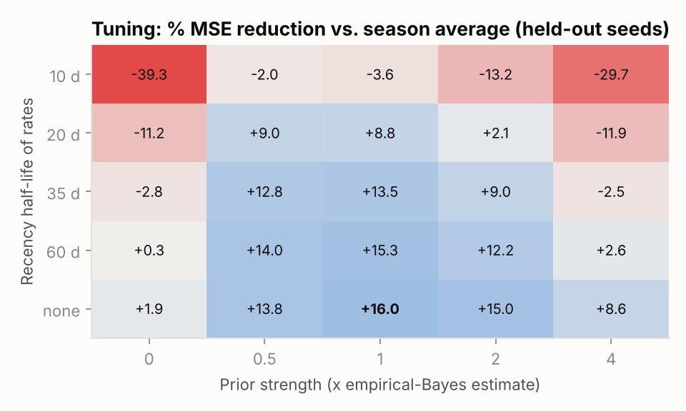
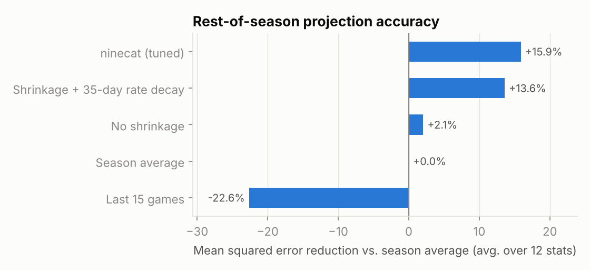
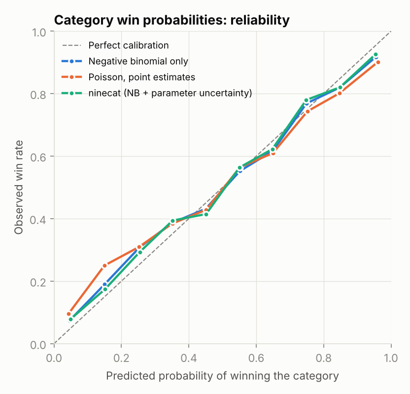
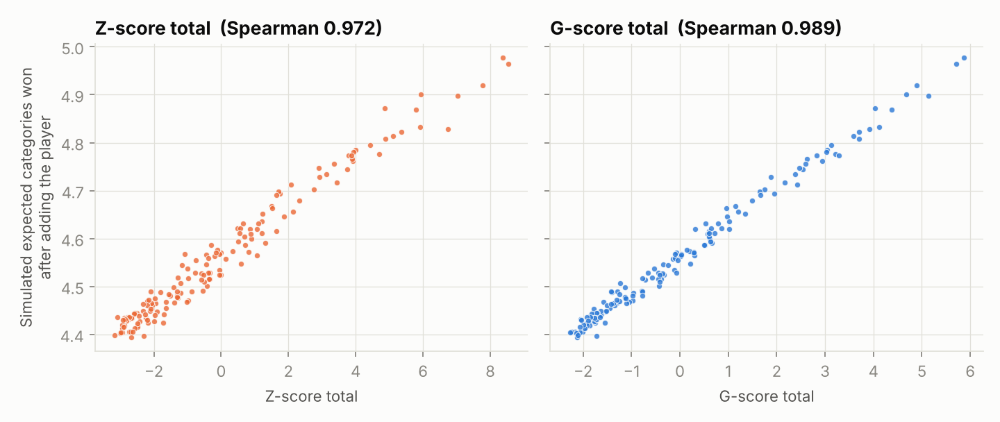
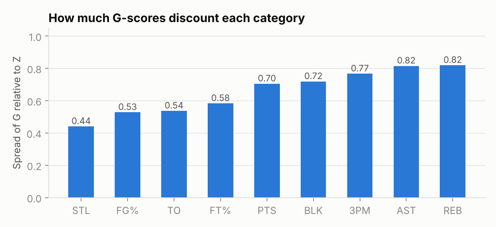

# Results

_Generated by `scripts/run_experiments.py` in 185s. All numbers come from synthetic seasons (see `docs/methodology.md`); tuning seeds [101, 102, 103] never overlap evaluation seeds [1, 2, 3, 4, 5]._

## 1. Projection tuning

The grid search picked **no decay** on per-minute rates and a prior strength of **1x** the empirical-Bayes estimate. That the best prior scale sits near 1x is a check that the method-of-moments prior is about right: shrinking harder or softer both lose accuracy.

## 2. Projection backtest

Rest-of-season per-game projections made at weeks 4, 8, 12 and 16, scored against what each player actually averaged afterwards (players with at least 5 games before and 10 after). Error is weighted by games played (attempts for FG%/FT%).

RMSE by stat (lower is better):

| model | MIN | FGA | FTA | 3PM | PTS | REB | AST | STL | BLK | TO | FG% | FT% | MSE reduction vs season avg |
|---|---|---|---|---|---|---|---|---|---|---|---|---|---|
| Last 15 games | 2.097 | 1.868 | 0.753 | 0.407 | 2.644 | 1.070 | 0.734 | 0.298 | 0.251 | 0.432 | 0.051 | 0.077 | -0.226 |
| Season average | 2.148 | 1.742 | 0.689 | 0.363 | 2.445 | 0.984 | 0.669 | 0.262 | 0.220 | 0.382 | 0.044 | 0.066 | 0.000 |
| No shrinkage | 2.053 | 1.717 | 0.682 | 0.361 | 2.419 | 0.969 | 0.663 | 0.261 | 0.219 | 0.380 | 0.044 | 0.066 | 0.021 |
| Shrinkage + 35-day rate decay | 2.053 | 1.680 | 0.666 | 0.340 | 2.373 | 0.948 | 0.644 | 0.222 | 0.189 | 0.345 | 0.040 | 0.059 | 0.136 |
| ninecat (tuned) | 2.053 | 1.674 | 0.659 | 0.336 | 2.366 | 0.939 | 0.637 | 0.219 | 0.185 | 0.340 | 0.039 | 0.057 | 0.159 |

Best model: **ninecat (tuned)**.

## 3. Matchup simulator calibration

Every league matchup from week 3 on is simulated at the start of the week, using only earlier games, then compared with the real result. A calibrated simulator's 70% calls come true 70% of the time.

Per category:

| variant | Brier | Log loss | ECE | n |
|---|---|---|---|---|
| Negative binomial only | 0.1839 | 0.5534 | 0.0285 | 3,402 |
| Poisson, point estimates | 0.1860 | 0.5657 | 0.0420 | 3,402 |
| ninecat (NB + parameter uncertainty) | 0.1838 | 0.5526 | 0.0295 | 3,402 |

Per matchup (overall win/loss):

| variant | Brier | Log loss | ECE | n |
|---|---|---|---|---|
| Negative binomial only | 0.1990 | 0.5942 | 0.0644 | 378 |
| Poisson, point estimates | 0.1991 | 0.5953 | 0.0652 | 378 |
| ninecat (NB + parameter uncertainty) | 0.1985 | 0.5911 | 0.0574 | 378 |

Overdispersion is what matters most: moving from Poisson to negative-binomial counts cuts category log loss from 0.5657 to 0.5534. Adding parameter uncertainty changes it to 0.5526 per category and 0.5942 -> 0.5911 per matchup, a small effect at this point in the season because most rostered players already have large samples.

## 4. G-scores vs Z-scores

Each player in the rostered pool is added to hundreds of random teams and simulated against random opponents. His true marginal value is the average gain in categories won. The better ranking is the one that orders players the same way.

| value measured by | score | Spearman rho (mean over seeds) | min | max |
|---|---|---|---|---|
| exp_categories | G | 0.988 | 0.984 | 0.989 |
| exp_categories | Z | 0.963 | 0.945 | 0.976 |
| win_prob | G | 0.985 | 0.979 | 0.987 |
| win_prob | Z | 0.958 | 0.935 | 0.972 |

G-scores track simulated value better (Spearman 0.988 vs 0.963). The gain comes from discounting volatile categories:

Caveat: the simulator's model of weekly variance is the same one G-scores assume, so this experiment shows G is the right summary *under that model*. Section 3 is the evidence that the model itself matches the data.
